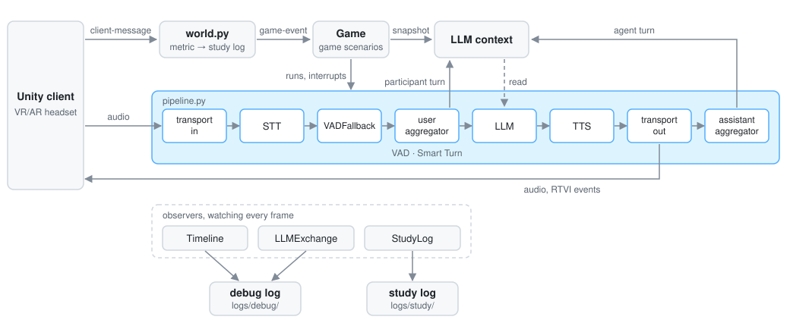

# Architecture

What the code does not say in one place: how data flows, where each configuration seam is, what the Unity client and the agent promise each other, what the logs hold, and how the benchmarks compare models. Module docstrings cover the rest.

## Data flow

A run starts by settling the session: `config.load` reads the environment, `session.resolve` takes the command line and opens the dialog for whatever is left open, and `roster` picks the session's log file. Only then does the agent start the LiveKit server, if nothing answers on its port yet, and the token endpoint the client joins through. A session on the `nemotron` STT also has `nemotron_server` bring up its NIM container through Docker Compose and waits until it is serving. The dialog already starts it when `nemotron` is selected and shows its progress next to the STT field, so this is usually only the wait. Unlike the LiveKit server, the container is left running after the session, since it takes about 40 s to start.

The pipeline runs in one direction:

```
transport in -> STT -> VADFallback -> user aggregator -> LLM -> TTS -> transport out -> assistant aggregator
```



`pipeline.py` is the only place it is assembled, and receives its transport, services, system prompt and tools rather than constructing them. Turn-taking is Pipecat's default: Silero VAD starts a turn, Smart Turn v3 ends it, and `VADFallback` ends a turn the VAD missed when the STT heard speech. Whichever of the two decides first ends the turn (`StrategyMode.FIRST`), since the fallback never decides on a turn VAD saw. The participant is muted until the opening has finished.

Audio enters at 16 kHz, which Silero VAD, Smart Turn and the STT require, and leaves at 48 kHz, native for ElevenLabs and LiveKit. The transport resamples once on the way in.

Observers watch the pipeline without being part of it: `Timeline` and `LLMExchange` write the debug log, `StudyLog` the study log, `ThoughtRelay` sends the LLM's thoughts to the client. `world.py` holds everything that passes between client and agent that is not audio.

A scenario with a game adds `Game` (`agent/game.py`), an observer that also queues frames. It turns each game snapshot from the client into the LLM context and decides when the agent speaks about it:

- Only the newest snapshot is in the context, swapped in place of the previous one and appended last, as a developer message headed as a game-state update the participant did not say. Mistral receives it as a user message.
- An event expires: 10 s after the newest snapshot (`EVENT_TIMEOUT_S`), it is swapped in again with `event` and `detail` set to null, so the agent does not take an old event for what just happened. A reaction still held keeps its event until it has run. Expiry is not a client event and appears only in the debug log's LLM contexts.
- A scenario without a greeting opens on the session's first snapshot. A scenario with a greeting opens on it and runs an intro: every snapshot enters the context, none is reacted to, and the study log labels it `intro`. The intro ends when the LLM calls `start_task`, the one tool, offered only then; its result runs the LLM again, which starts the task from the newest snapshot.
- After the opening or the intro, the scenario's reaction table decides per snapshot: `silent` updates the context and nothing more; `when_idle` runs the LLM once nobody is speaking, no reply is generating and none is waiting to be heard, after a 0.3 s grace; `interrupt` cuts the agent off and runs the LLM at once, unless the participant is speaking, when it waits like `when_idle`.
- Reactions held while the agent is busy collapse into one run. A run that starts on a context already holding the snapshot, such as the participant's own turn, settles the held reaction, so the agent does not answer the same state twice.

## Transport

LiveKit carries audio and events between the agent and Unity. Audio is a WebRTC track, so the LiveKit Unity SDK handles jitter buffering, playback and congestion control rather than client code. Turn-start stutter and late interruptions live in exactly that code. Events go through the same room as data packets, so neither side maintains its own framing, and Pipecat's `LiveKitTransport` and the LiveKit Unity SDK speak it already. LiveKit is the transport only: the agent logic is Pipecat's pipeline, and LiveKit Agents is not used.

## Configuration seams

Each choice is made in one place and reaches the command line and the dialog from there.

- Models: `agent/services/catalog.py`, name to factory, with `DEFAULTS` and the languages each voice speaks. A factory imports its provider inside the function, so selecting one model never loads another's dependencies. Every entry names a pinned snapshot such as `mistral-small-2603`, never a `-latest` alias, so a provider cannot change the model under a running study; a retired snapshot fails at startup instead. Every Mistral LLM entry fixes its `reasoning_effort`: `none` where the model can turn reasoning off (`mistral-small`), otherwise the lowest it accepts (`low` for `mistral-large`). Mistral streams thinking as content parts; `agent/services/mistral_llm.py` turns them into Pipecat's `LLMThought*` frames, so thinking never reaches TTS or the LLM context, and passes only the answer on as text. A request that ends on a tool result goes out as it is: Pipecat's Mistral adapter would append a blank assistant reply marked as a prefix to continue, which Mistral does not need and Large 4 refuses.
- Scenario: `agent/scenarios/`, name to `Scenario`: the system prompt, an optional fixed greeting, and the reaction table for a scenario with a game. A game with a greeting opens with an intro. What a session is about varies here and nowhere else. Each scenario has its own folder, and its `README.md` describes it: persona, opening, and the game events it takes.
- Transport: `session.TRANSPORTS`. LiveKit is the only one.
- Session: participant ID, language (`config.LANGUAGES`, English or German) and `--vision`, on the command line or in the dialog.

A field with a single option is settled without asking. A command line naming the participant, the language and every field with a choice starts headless.

## Unity contract

The Unity client is a separate project. This section is what both sides hold to.

Connecting:

- Unity fetches its connection details from `POST /getToken` on port 8080, LiveKit's standard token endpoint format: a body naming `room_name`, `participant_identity` and `participant_name`, or an empty one to take the configured room and the identity `unity`. It is answered with `server_url` and `participant_token`. The Unity SDK's `TokenSourceEndpoint` speaks this already.

Messages:

- Everything that is not audio or video is one reliable LiveKit data packet per message, in Pipecat's RTVI envelope: `{"label": "rtvi-ai", "type": ..., "id": ..., "data": ...}`. A reliable packet caps at 15 KiB, so anything larger than small JSON is a track or a byte stream, never a packet.
- Custom messages carry `{"t": <type>, "d": <data>}`: a `client-message` from Unity, a `server-message` from the agent.

Handshake:

- Unity sends `client-ready` naming its RTVI protocol version. Pipecat 1.15 speaks 2.3.0 and serves any 2.x client fully; a mismatched major version is answered with an error and the session continues degraded. The version is re-checked on every Pipecat upgrade.
- The agent answers with `bot-ready` and, alongside it in either order, a server-message `{"t": "session", "d": {...}}` carrying every setting of the session, the fields of `session_start` in the study log. Unity takes what it needs, such as the language for its UI, and ignores the rest.
- The agent then opens the conversation as the scenario defines: a fixed greeting spoken at once, or, for a scenario with a game and no greeting, the LLM's first run once the first snapshot arrives.

Agent to Unity, with no agent code behind them: `bot-started-speaking`, `bot-stopped-speaking`, `bot-tts-started`, `bot-tts-stopped`, `bot-tts-text` word by word, `bot-output`, `user-started-speaking`, `user-stopped-speaking`, `user-transcription`, `bot-interrupted` and `metrics`. These are the animation and interruption triggers.

Agent to Unity, from agent code: a server-message `{"t": "thought", "d": {"text": ...}}` with each LLM thought whole, sent when the thought ends, which is before the answer it led to is spoken. Only a reasoning model thinks, so a session on `mistral-small` sends none.

Unity to agent:

- `metric`: a measurement, written to the study log as sent, so Unity adds one without a backend change. By convention `d` carries a `name`.
- `game-event`: a full snapshot of the game's state, taken only by a scenario with a game. What `d` holds and how each event is reacted to is in that scenario's `README.md`.
- Any other client-message type is logged as unhandled.

Camera: Unity publishes its camera as an ordinary video track, low resolution and low frame rate, and leaves it open. `--vision` decides whether the agent subscribes. Frames are held and never reach the LLM.

## Logs

Raw audio is never written. Participants are identified by pseudonymous ID only.

Participant IDs: any string that can name a file. `P` and a number is the numbered form, stored with at least two digits, so `p4` becomes `P04`. The dialog suggests one past the highest number any study log has used. A participant's first session is `P04`, a re-run `P04-2`, and an existing log is never reopened. `test` is offered for trying the platform out and is never counted.

Two logs per session:

- `logs/study/<session>.jsonl`, the record the analysis reads. One JSON line per event, flushed as written, each stamped with `ts`, `iso` and the current `turn`. `session_start` names participant, session, language, scenario, transport, vision, the models by catalog name and by the provider's model ID (`stt_model`, `llm_model`, `tts_model`), and the code version; then `client_ready`, `user_transcript` and `assistant_message` as they entered the LLM context, `llm_thought` with each thought of a reasoning model whole, `tool_call`, `turn_started` and `turn_ended` with duration, interruption and usage, `response_latency` with its `latency_breakdown` stage by stage, `first_speech_latency` once, `interruption_latency`, `client_metric` from Unity, and `game_event` with the snapshot as `data` and its `reaction` (`opening`, `intro`, `silent`, `when_idle` or `interrupt`). `session_end` closes it with totals.
- `logs/debug/<session>_<start time>.jsonl`, for debugging: every log record of the run, every frame once, and every LLM call with the full context it was given, its tool calls and its output.

## Benchmarks

`bench/` measures catalog models outside a session, so a model can be compared with its predecessors and successors. Both runners build their service through `catalog.py`, so they measure the same Pipecat service and settings a session runs; `--model` replaces the entry's snapshot, which keeps a model measurable after the catalog has moved on, and `--reasoning` its reasoning effort, for a snapshot that refuses the entry's own.

- `bench/llm.py` replays the cases in `bench/cases/llm/`, scripted conversations built from session logs. A case names a scenario and language and lists steps: `game` swaps in a snapshot as `Game` does, `say` adds a participant line, `agent` and `tool` add history a case states rather than generates. A `say` runs the LLM unless `run` is false, a `game` only when `run` is true. The LLM sits between the context aggregators of a session, on a context opening with the scenario's system prompt, greeting and tools, and `start_task` answers as the game does. Each run's expectations are checked by rule (`called`, `not_called`, `mentions`) or by a yes/no question to the judge, `mistral-large` at reasoning effort `high`, since it is never spoken; every reply is also checked for formatting and for naming the game state, and its words and sentences counted. `expect` on the case checks the whole conversation.
- `bench/stt.py` plays the recordings in `bench/cases/stt/` in real time, plus 2 s of silence, through Silero VAD into the STT, and scores the final transcripts against the reference by word error rate, ignoring case, punctuation and hyphens. Latency is the STT's own TTFB metric, speech end to final transcript.
- `bench/results/llm.jsonl` and `stt.jsonl` are append-only, one line per repetition, kept on disk. A line names the catalog entry, model, the service's full settings, case, repetition and code version. For the LLM it also holds per step the reply, tool calls, time to first spoken word, TTFB, tokens, checks and judge reasons. Comparable lines share a key: model, settings and the hash of the case file, plus for the LLM the hash of the scenario setup (prompt, greeting, tools, tool result, snapshot header) and of the judge (its settings and instructions). A run tops each key up to `--reps` error-free repetitions, so a model is measured once per version of the case and setup.
- `bench/report.py` prints one table per case and key, a row per model and settings.
