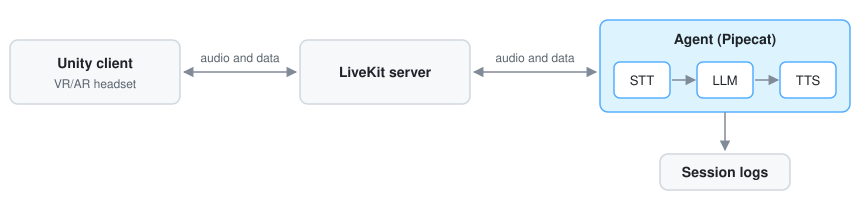

# TrIVA-Backend

**An Intelligent Virtual Agent (IVA) pipeline built for developing and studying trustworthy IVAs in XR.**

Python backend of TrIVA, an embodied AI agent in VR/AR. Pipecat orchestrates the AI models; LiveKit carries audio and data to the Unity client in [TrIVA-Unity](https://github.com/TrIVAs/TrIVA-Unity).



## Setup

Windows, with [uv](https://docs.astral.sh/uv/) installed. uv fetches Python 3.14 itself.

1. Install the dependencies.

   ```powershell
   uv sync
   ```

2. Copy `.env.example` to `.env` and fill in the API keys.

3. Download `livekit-server.exe` from the [LiveKit releases](https://github.com/livekit/livekit/releases) into the project root. The agent starts it when nothing listens on `LIVEKIT_URL` yet.

4. Optional, for `--stt nemotron`: a local NVIDIA NIM container from `nemotron.compose.yaml`, which needs Docker Desktop, an NVIDIA GPU and an [NGC API key](https://org.ngc.nvidia.com/setup/api-keys). Put `NGC_API_KEY` in `.env`, log in with `docker login nvcr.io` (user `$oauthtoken`, the key as password), then build the model once:

   ```powershell
   docker compose -f nemotron.compose.yaml run --rm nemotron-export
   ```

   This takes about 15 minutes and writes the built model to `%USERPROFILE%\nim_export`. Run it only once: it rebuilds from scratch each time, and the build only barely fits an 8 GB GPU, so close Unity and the headset software first. From then on the dialog starts the container as soon as `nemotron` is selected, or the agent does at the start of a scripted run. It takes about 40 s and stays running for the next session.

## Running

### Interactive

```powershell
uv run python -m agent.run
```

A dialog asks for participant ID, language, scenario and models. With the Rocketbox demo from TrIVA-Unity, pick the `chat` scenario: `lab` greets and chats, but its task runs on game snapshots, which the demo does not send.

> [!NOTE]
> IDs of the form `P` and a number, such as `P04`, count as study participants. Any other ID, such as `test`, is for development.

### Scripted

Naming everything on the command line skips the dialog:

```powershell
uv run python -m agent.run `
    --participant test `
    --language en `
    --scenario chat `
    --stt nemotron `
    --llm mistral-small `
    --tts elevenlabs-flash
```

### Without Unity

`tools.local_client` lets you talk to the agent through the local microphone and speakers without Unity. It currently works with the `chat` scenario only: `lab` greets and chats, but its task runs on Unity's game snapshots, which the local client never sends. If no agent is running, the client starts one in a new console with `--scenario chat --participant dev`, and the dialog asks for the rest:

```powershell
uv run python -m tools.local_client
```

### Logs

Each session writes a study log and a debug log under `logs/`.

### Tests

- `uv run pytest`

- `tests/test_live_client.py` checks the Unity protocol against a running agent: token, handshake and camera track. Run with `uv run pytest -m live`

### Benchmarks

Measure a catalog model on scripted lab conversations or recorded speech, and compare it with every model measured before. A run only adds the repetitions still missing, so rerunning costs nothing until a case, the prompt or the model changes.

```powershell
uv run python -m bench.llm --llm mistral-small
uv run python -m bench.llm --llm mistral-small --model mistral-medium-2604
uv run python -m bench.stt --stt voxtral
uv run python -m bench.report
```

`--model` measures another snapshot of the same provider, such as one the catalog no longer lists, and `--reasoning` sets the reasoning effort (`none`, `low`, `medium`, `high`) for a snapshot that refuses the entry's own. `--case` picks cases by file name and `--reps` sets the repetitions, 5 for the LLM and 3 for the STT by default. Cases live in `bench/cases/`, results in `bench/results/`; see [`ARCHITECTURE.md`](ARCHITECTURE.md#benchmarks).

## Adding a model

Every model is a named entry in `agent/services/catalog.py`, and a new entry shows up on the command line and in the dialog at once.

| Adding…                                 | What to change                                                                                                                                                                                                                                                                                                                      |
|-----------------------------------------|-------------------------------------------------------------------------------------------------------------------------------------------------------------------------------------------------------------------------------------------------------------------------------------------------------------------------------------|
| Another model from an existing provider | One line in the `STT`, `LLM` or `TTS` registry, such as `"ministral-8b": partial(_mistral_llm, model="ministral-8b-2512")`. Name a pinned snapshot, never a `-latest` alias.                                                                                                                                                                                                     |
| A new provider                          | A factory beside the others that builds its Pipecat service and imports it inside the function.<br/>Add the provider's extra to `pipecat-ai[...]` in `pyproject.toml` and run `uv sync`.<br/>If it needs a key, add it to `Config` and `load()` in `agent/config.py`, to `.env.example`, and read it in the factory with `_demand`. |
| A voice                                 | Also an entry in `TTS_LANGUAGES` naming the session languages it speaks.                                                                                                                                                                                                                                                            |

## Further reading

| Document                             | What it covers                                                                          |
|--------------------------------------|-----------------------------------------------------------------------------------------|
| [`ARCHITECTURE.md`](ARCHITECTURE.md) | Data flow, configuration seams, the Unity contract, the log formats and the benchmarks. |
| `agent/scenarios/<name>/README.md`   | What each scenario is about and which game events it takes.                             |
| [`ROADMAP.md`](ROADMAP.md)           | Upcoming work.                                                                          |
