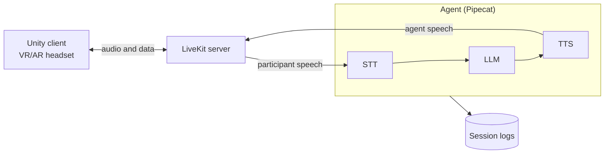

# XAI-Companion

**A study platform for transparent, trustworthy AI Agents in XR.**

Backend for an Intelligent Virtual Agent, an embodied AI human in VR/AR, built as a reusable platform for user studies on transparent and explainable agents in XR. Pipecat orchestrates the AI models; LiveKit carries audio and data to a Unity client, which is a separate project.



## Setup

Windows, with [uv](https://docs.astral.sh/uv/) installed. uv fetches Python 3.14 itself.

1. Install the dependencies.

   ```powershell
   uv sync
   ```

2. Copy `.env.example` to `.env` and fill in `MISTRAL_API_KEY` and `ELEVENLABS_API_KEY`.

   ```powershell
   Copy-Item .env.example .env
   ```

   > [!NOTE]
   > The agent reads `.env` before anything else, so even `--help` needs it.

3. Download `livekit-server.exe` from the [LiveKit releases](https://github.com/livekit/livekit/releases) into the project root. The agent starts it when nothing listens on `LIVEKIT_URL` yet.

## Running

### Interactive

```powershell
uv run python -m agent.run
```

A dialog asks for participant, language, scenario and models.

> [!TIP]
> Use the participant `test` for trying things out; it never counts as a participant.

### Scripted

Naming everything on the command line skips the dialog:

```powershell
uv run python -m agent.run `
    --participant test `
    --language en `
    --scenario chat `
    --stt voxtral `
    --llm mistral-small `
    --tts elevenlabs-flash
```

### Without a headset

`tools.client_peer` stands in for the Unity client on the data channel.

```powershell
uv run python -m tools.client_peer
```

### Logs

Each session writes a study log and a debug log under `logs/`, which stays on the machine and out of git.

### Tests

```powershell
uv run pytest
```

## Adding a model

Every model is a named entry in `agent/services/catalog.py`, and a new entry shows up on the command line and in the dialog at once.

| You're adding… | What to touch |
| --- | --- |
| Another model from a provider already there (Mistral, ElevenLabs, Whisper, Kokoro) | One line in the `STT`, `LLM` or `TTS` registry, such as `"mistral-large": partial(_mistral_llm, model="mistral-large-latest")`. |
| A new provider | A factory beside the others that builds its Pipecat service and imports it inside the function. Add the provider's extra to `pipecat-ai[...]` in `pyproject.toml` and run `uv sync`. If it needs a key, add it to `Config` and `load()` in `agent/config.py`, to `.env.example`, and read it in the factory with `_demand`. |
| A voice | Also an entry in `TTS_LANGUAGES` naming the session languages it speaks. |

## Further reading

| Document | What it covers |
| --- | --- |
| [`ARCHITECTURE.md`](ARCHITECTURE.md) | Data flow, configuration seams, the Unity contract and the log formats. |
| `agent/scenarios/<name>/README.md` | What each scenario is about and which game events it takes. |
| [`PLAN.md`](PLAN.md) | Upcoming work. |
